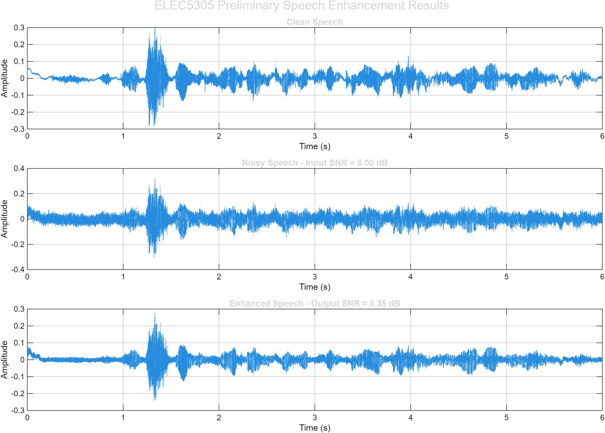
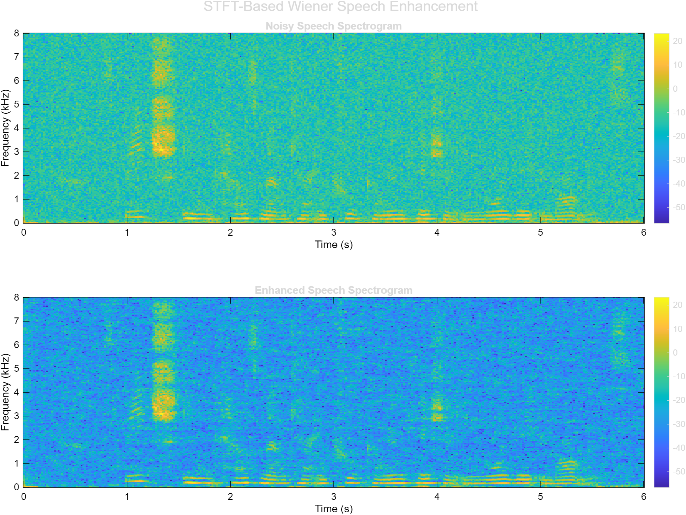
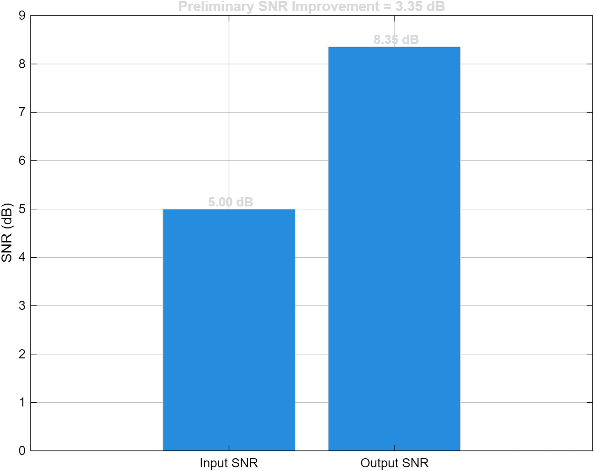

# STFT-Based Speech Enhancement Using Wiener Filtering in Noisy Environments

## ELEC5305 Project

This project investigates speech enhancement using the Short-Time Fourier Transform (STFT) and Wiener filtering under different noisy conditions.

## Project Overview

Speech recordings are often affected by environmental background noise, which can reduce speech intelligibility and degrade the performance of speech processing systems. This project aims to develop a speech enhancement system based on time-frequency signal processing.

The noisy speech signal will first be analysed using the Short-Time Fourier Transform (STFT). A Wiener filter will then be applied in the time-frequency domain to suppress noise components while preserving the speech signal. The enhanced speech will be reconstructed using the inverse STFT.

## Objectives

- Analyse noisy speech signals in the time-frequency domain using STFT.
- Implement Wiener filtering for speech enhancement.
- Test the algorithm under different noise levels.
- Compare noisy and enhanced speech using spectrograms.
- Evaluate performance using Signal-to-Noise Ratio (SNR) improvement.

## Methodology

The proposed processing pipeline is:

Clean Speech  
→ Add Environmental Noise  
→ STFT  
→ Noise Spectrum Estimation  
→ Wiener Filtering  
→ Inverse STFT  
→ Enhanced Speech  
→ Performance Evaluation

## Tools

- MATLAB
- GitHub
- Audio and speech datasets

## Expected Results

The project is expected to produce a MATLAB-based speech enhancement system capable of reducing background noise in speech recordings. Performance will be evaluated using objective measures such as SNR improvement together with waveform and spectrogram comparisons.

## Project Proposal

[View the Project Proposal](ELEC5305%20Project%20Proposal.pdf)
## Project Status

Project proposal and initial planning stage.

## Course

ELEC5305 – Acoustics, Speech and Signal Processing  
The University of Sydney

## Project Feedback Two - Preliminary Progress

A preliminary MATLAB implementation of the proposed STFT-based Wiener speech enhancement system has now been developed and tested.

The current implementation performs the following steps:

- Loads a clean speech recording.
- Adds synthetic Gaussian white noise at a controlled input SNR.
- Divides the signal into overlapping short-time frames.
- Performs Short-Time Fourier Transform (STFT) analysis.
- Estimates the noise power spectral density from the initial silent region.
- Applies Wiener filtering in the time-frequency domain.
- Reconstructs the enhanced speech using weighted overlap-add.
- Evaluates the system using input SNR, output SNR, waveforms, spectrograms, and listening comparisons.

### Preliminary Experimental Setup

The preliminary experiment used:

- Sampling rate: 16 kHz
- Input SNR: 5 dB
- Frame length: 512 samples
- Hop length: 256 samples
- FFT length: 512 samples
- Noise type: Gaussian white noise

### Preliminary Results

The preliminary experiment produced the following quantitative results:

| Metric | Result |
|---|---:|
| Input SNR | 5.00 dB |
| Output SNR | 8.35 dB |
| SNR Improvement | 3.35 dB |

The positive SNR improvement indicates that the preliminary Wiener filtering system reduced the added background noise while retaining the major speech components.

### Waveform Comparison

The noisy signal contains a visibly higher background noise level than the clean speech. After Wiener filtering, the enhanced waveform shows reduced background noise while retaining the main temporal structure of the speech signal.

### Spectrogram Comparison

The enhanced spectrogram shows reduced broadband background energy compared with the noisy speech spectrogram, while the dominant speech time-frequency structures remain visible.

### SNR Comparison

The measured SNR increased from 5.00 dB before enhancement to 8.35 dB after enhancement, corresponding to a preliminary improvement of 3.35 dB.

### Current Status and Next Steps

The basic STFT-based Wiener speech enhancement pipeline is now operational. Further work will focus on testing additional input SNR conditions, evaluating different types of environmental noise, improving noise estimation, and performing a more systematic quantitative evaluation for the final project.